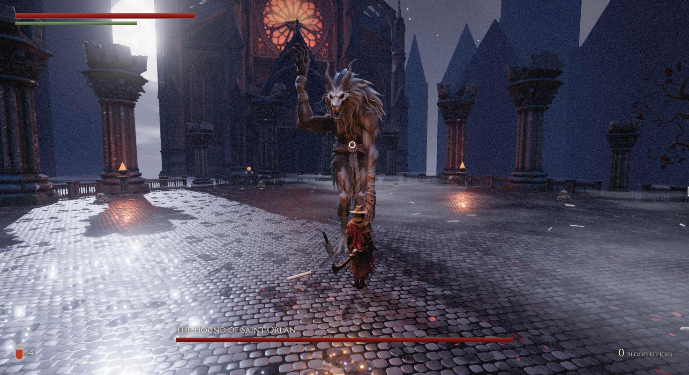
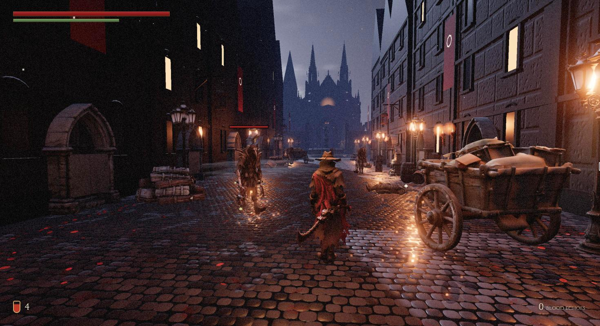

# The Last Hunt

A dark gothic action game in the spirit of the Souls series, playable in your browser.

You are a hunter sent into **Saint Orlan's Ward**, a plague-sealed district of the city of Veyr. Fight your way through a moonlit street and a ruined plaza, climb the cathedral steps, pass through the fog, and face **the Hound of Saint Orlan**.



**▶ Play:** https://giova333.github.io/the-last-hunt/ (desktop or phone, no install)

This is a **vertical slice**: one complete level with one boss.

## The game

- **Deliberate combat.** Every swing, roll and sprint costs stamina. Read the enemy, dodge through its attack, then punish.
- **Strike back to heal.** Damage you take can be partly won back by hitting the enemy within a few seconds.
- **Blood vials.** You carry four. Lighting or resting at a lantern refills them, saves your progress, and brings enemies back.
- **Plague Seers.** Erratic beak-masked figures with heavy censers that roam the streets.
- **The Hound.** A 6-metre two-phase boss. At half health it roars, the cathedral's rose window turns blood-red, and it gets faster and more aggressive.
- **Atmosphere.** Wet cobblestones, fog, torch-lit houses, an original orchestral score and positional sound.



## Controls

| Keyboard and mouse | |
|---|---|
| **WASD** / **Shift** | move / sprint |
| **Left click** | slash (press again for a 3-hit combo) |
| **Right click** or **F** | heavy cleave |
| **Space** | roll (invulnerable for a moment) |
| **Q** or **Tab** | lock on to an enemy |
| **R** | drink a blood vial |
| **E** | interact: lanterns, notes, fog gate |
| **Esc** | pause |

**On a phone or tablet,** touch controls appear automatically. Left thumb: joystick (push to the edge to sprint). Right thumb: drag to look. On-screen buttons: slash, heavy, roll, vial, lock, use. Landscape works best.

## Run it locally

Requires [Node.js](https://nodejs.org) 20+.

```bash
npm install
npm run dev      # open http://localhost:5173
npm run build    # production build in dist/
```

## How it was made

Built with AI-assisted tools, starting from the concept art in `images/`:

- **3D models.** [Tripo](https://www.tripo3d.ai) generated the characters (with rigging and animation), weapons, props and the cathedral, from the concept art or text descriptions.
- **Model cleanup.** [Blender](https://www.blender.org) ran headless from scripts in `tools/` to merge animations, orient and scale models, and compress textures.
- **Music and sound effects.** Generated with [ElevenLabs](https://elevenlabs.io).
- **Engine.** [Three.js](https://threejs.org) in plain JavaScript, built with [Vite](https://vitejs.dev).
- **Animation in code.** The hunter's sword cuts, the Hound's claw attacks and vial drinking are animated procedurally, layered on the generated animations.
- **Built with [Claude Code](https://claude.com/claude-code).**

The generation commands are listed in [`tools/`](tools/). Sound generation reads an ElevenLabs key from a git-ignored `.env.local` file.

## Project layout

```
src/            game code: main.js (loop), world.js (level), player.js, seer.js, boss.js,
                swing.js / claws.js / drink.js (procedural animation), audio.js, ui.js, touch.js
public/models/  characters, weapons and environment props (.glb)
public/audio/   music and sound effects
tools/          asset generation and Blender processing scripts
images/         original concept art
```

## Deploying

The site is static and uses relative paths, so it works from any folder. Every push to `main` builds and publishes it to GitHub Pages through `.github/workflows/deploy.yml`. To set this up once: repository **Settings → Pages → Source: GitHub Actions**.

## About the story

The world draws on an in-progress story bible: the city of Veyr, the substance called Grace, and the purge of Saint Orlan's Ward. The in-game notes and the boss's name are placeholders written in that tone, not final canon.
